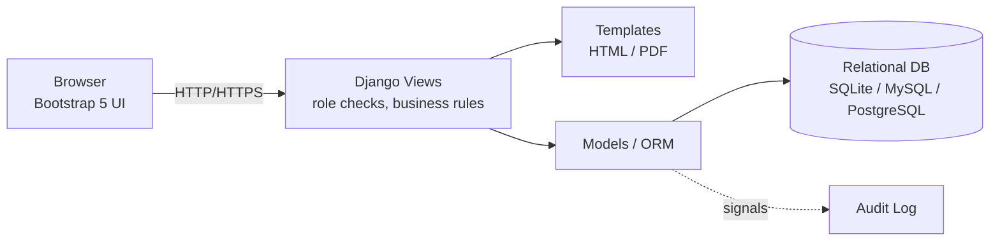
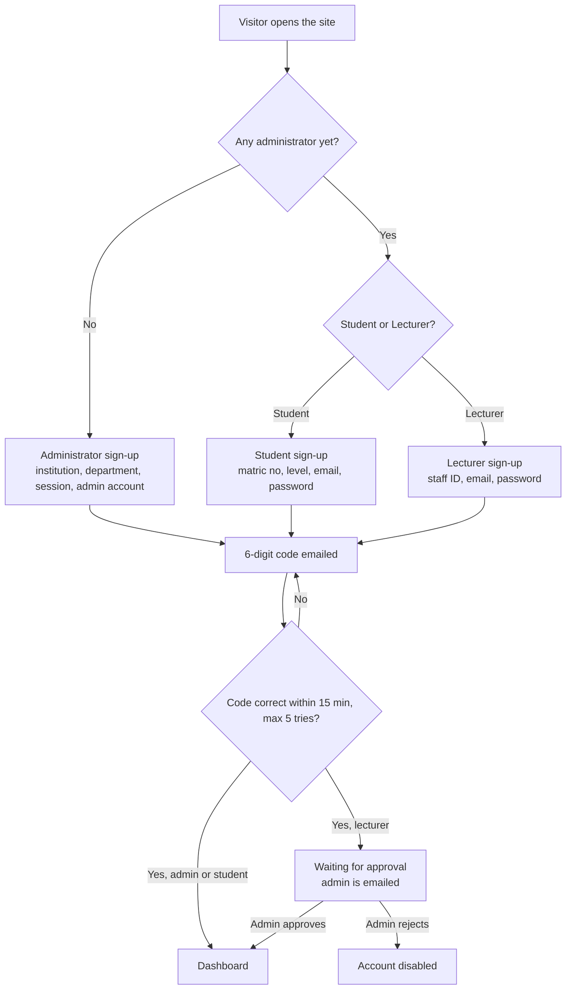
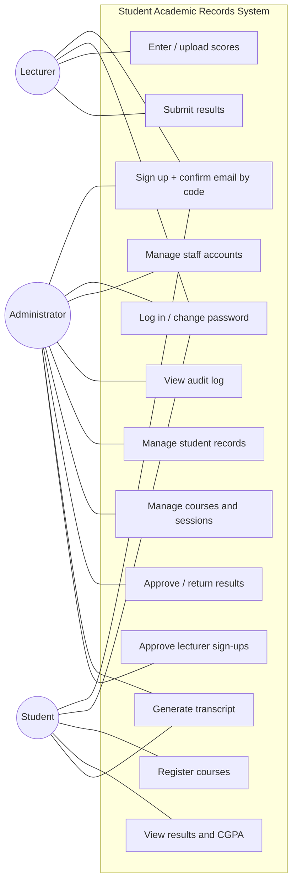
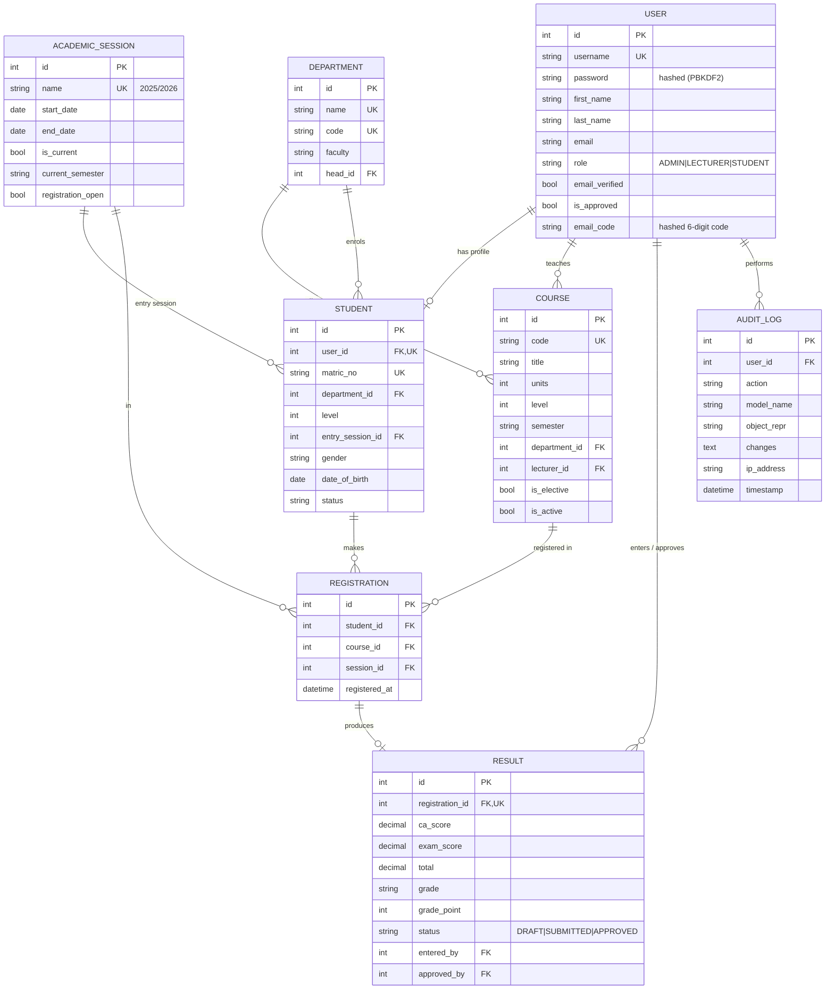
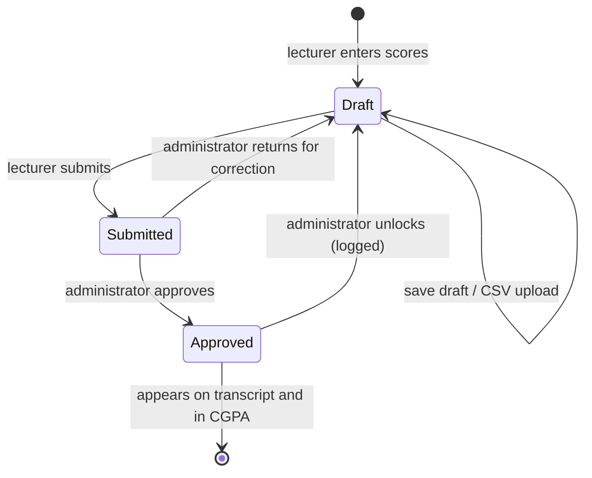

# System Design

This document describes the design of the Centralized Student Academic Records Database System. You can use it as the basis for the system analysis and design chapter of the project report.

## 1. Problem statement

In many departments, student records are kept in paper files and separate spreadsheets held by different offices. This causes:

- duplicated and inconsistent records;
- slow, error-prone GPA calculation and transcript preparation;
- no single source of truth;
- weak access control, so results can be changed without trace;
- lost records and difficult retrieval.

## 2. Objectives

1. Design a normalised relational database that stores all student academic records centrally.
2. Implement a web application with self sign-up, email verification and role-based access for administrators, lecturers and students.
3. Automate grade, GPA and CGPA computation and transcript generation.
4. Enforce data integrity through validation, a result approval workflow and a tamper-evident audit trail.

## 3. Methodology

The system follows a three-tier **Model-View-Template (MVT)** architecture, implemented with Django:



- **Presentation tier:** HTML templates styled with Bootstrap 5, plus PDF output through ReportLab.
- **Application tier:** Django views that enforce access control, validation, grading rules and the approval workflow.
- **Data tier:** a relational database reached through the Django ORM, using parameterised queries that guard against SQL injection.

The development approach was incremental (iterative waterfall): requirements → database design → implementation module by module → testing.

## 4. Users and roles

| Role | Permissions |
|---|---|
| Administrator | First person to sign up. Approves lecturer sign-ups; manages students, courses and sessions; approves or returns results; views the audit log; unlocks approved results; takes backups. |
| Lecturer | Signs up, then waits for the administrator's approval. Views assigned courses. Enters and uploads scores and submits them for approval. |
| Student | Signs up with matric number and email and gets access immediately. Views own profile and results, registers courses while registration is open, and downloads own transcript. |

## 4b. Sign-up and account activation



## 5. Use case diagram



## 6. Database design (ERD)



**Normalisation:** the schema is in Third Normal Form.

- A student's course history is held in `REGISTRATION`, with a unique constraint on (student, course, session) that prevents duplicate registrations.
- Scores live in `RESULT`, one per registration.
- `total`, `grade` and `grade_point` are derived when a result is saved, and are stored so transcripts can be generated quickly.
- GPA and CGPA are never stored. They are always computed from approved results, so they cannot become inconsistent.

## 7. Key processes

### Result workflow



### GPA computation

```
GPA  = Σ (course units × grade point) / Σ (course units)   for one semester
CGPA = same formula over all approved results to date
```

## 8. Security measures

- Passwords hashed with PBKDF2 (Django default), with password strength validators.
- Role-based access checked on the server for every view (`accounts/decorators.py`); students can access only their own records.
- CSRF tokens on all forms; sessions expire after 2 hours or when the browser closes.
- ORM queries are parameterised, which prevents SQL injection.
- Server-side validation of all scores (CA 0–30, exam 0–70) and of uploaded files (CSV only, up to 2 MB).
- Approved results are locked against editing.
- A read-only audit log records every change, with the old value, new value, user and IP address.

## 9. Testing

Automated tests live in `records/tests.py` and run with `python manage.py test`:

| Test | Purpose |
|---|---|
| Grade boundaries | Each score maps to the correct grade and grade point |
| GPA weighting | GPA is weighted by units; unapproved results are excluded |
| Unique registration | Database rejects duplicate registrations |
| Audit trail | Updates are logged with field changes |
| Access control | Login required; students and lecturers limited correctly |
| Course registration | Unit limit respected; closed registration blocks students |
| Result workflow | Enter → submit → approve; approved results locked |
| Validation | Out-of-range scores rejected |
| CSV upload | Bulk scores applied; unknown matric numbers reported |
| Student creation | Creates linked login account |
| Transcript | HTML and PDF generated |
